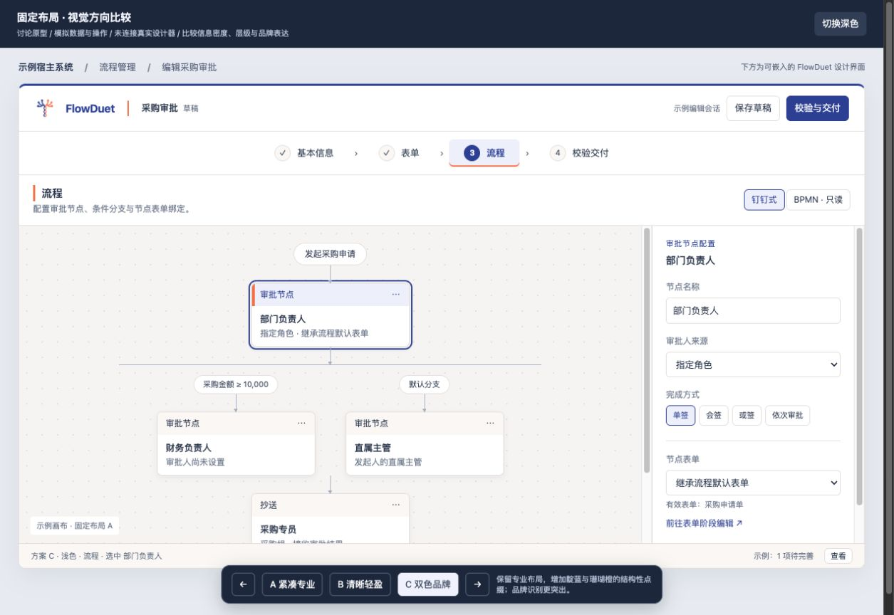

# FlowDuet 设计体系 v1 与阶段式设计工作台

## 2026-10-25 收尾裁定（当前执行依据）

维护者已确认停止阶段零追加实验，并授权本地 P2 整合、正常交付校验及收尾文档更新。当前工作以[收尾清单与合并安排](2026-10-25-stage-zero-closeout-inventory.md)为准：已合入的 P0/P1 保持，P2 独立整合；供应商候选、P3/P4、完整主题/G2 与原整体计划任务 5–7 冻结，完整工作台和设计系统暂缓。普通产品交付校验另行执行，不继承整个供应商实验矩阵。不推送、不开远端 PR、不发布，也不直接合并 develop。

原技术结论和失败事实不变，阶段零完整目标未验收通过；长期设计合同保持。本页历史内容中的“继续执行”“下一步补跑”和旧待批准事项不再构成当前行动指令。现有产品的内容保真和宿主安全仍是限定交付底线，不能用范围缩减豁免实际缺陷。

## 历史方案与依据

2026-10-15 阶段状态：前置结构修复已随PR #92合入develop；对象生命期、编辑缓冲和分支定位复验已更新。[阶段零验收](system-v1/probes/README.md)B02/B05候选合同已通过，仍有B01/B03/B04阻断，不进入正式工作台实现或公开接口冻结。

- 日期：2026-10-14。
- 状态：整体方案和计划已获准执行，阶段零已形成本轮证据并完成独立复核；出口尚未通过，见 [阶段零结果](system-v1/probes/README.md)。生产结构修复已随 PR #92 合入 develop；正式工作台尚未实施。
- 决策来源：[方向质询记录](experience-redesign-discussion.md)、[ADR-0008](../adr/0008-logo-visual-identity.md)、[ADR-0010](../adr/0010-integrated-designer-delivery.md)。
- 代码核查基线：`a72dc9de01d235ad3876f118044bd3dfb730416d`；初稿提交：`50d977d`。审核意见逐项处理见 [复核记录](reviews/2026-10-14-review-response.md)。

## 1. 目标与取舍

为流程实施顾问提供一致、可精确配置的流程与表单设计体验，优先完成“新建设计 → 配置流程与表单 → 校验修复 → 交付”的完整路径。覆盖结构、操作路径、入口和视觉，不限于换色。

默认采用阶段式工作台：基本信息、表单、流程、校验交付。阶段代表任务组织方式，不强制完成顺序；顶部阶段导航与固定属性面板为已选布局。完整界面可以嵌入宿主，独立组件继续可用，存储与发布由宿主接管。

固定面板与 ADR-0003 第 1 条的抽屉约束存在范围差异，已提出 [ADR-0011](../adr/0011-property-editing-containers.md) 明确补充关系：新工作台使用固定面板，既有独立组件默认抽屉合同保留。该局部补充已接受，不表示历史决策已整体废止。

视觉沿用“一树两冠”、靛蓝与珊瑚橙，采用已选“双色品牌”方向。首期同时提供浅色和深色主题，宿主可定制基础视觉、紧凑/舒适密度与属性面板宽度。桌面编辑优先，适配依据是容器宽度。

下面的接口接缝、默认值取舍及验收设计是本提案的工程建议；精确 token 数值和组件状态稿在阶段一形成，不把讨论原型当成已验收的设计规范。

## 2. 首期范围

| 范围       | 本轮交付                                                                         |
| ---------- | -------------------------------------------------------------------------------- |
| 品牌到界面 | 标志使用、主辅色、状态语义、文字层级、间距、边框、圆角、阴影、焦点与动效规则     |
| 主题       | 浅色、深色，以及两档密度；宿主基础定制；弹层与第三方组件一同适配                 |
| 工作台     | 四阶段导航、固定属性面板、宿主加载/保存/交付动作入口、节点与表单之间的上下文往返 |
| 流程组件   | 统一节点、分支、连线、选择态、属性编辑和错误反馈；BPMN 保持当前只读能力          |
| 表单集成   | 统一目录、编辑、绑定、预览与状态反馈；维持已支持字段及 schema 边界               |
| 新增能力   | 集中校验、定位已知配置对象；跨阶段保留未完成输入与编辑上下文                     |
| 集成与验收 | 整套工作台和独立组件都可消费；Playground 验证完整主路径与宿主适配                |

未单独确认的功能不随本轮进入实施：BPMN 编辑、撤销重做、协同、自动持久化保存、历史版本、跨流程表单库、移动端完整编辑。官网改版、宣传物料与 i18n 本轮不做；不借重设计扩充表单字段类型或修改 schema 范围。

原型中的流程描述、角色选择器等代表字段只用于比较布局，不因此增加正式功能。审核反馈后已确认流程身份能力：新建时填写或由宿主提供 ID 与名称，创建后 ID 只读、名称可修改；宿主检查部署范围内的 ID 冲突。新建复用现有 session 参数，补充合法性校验和名称修改合同，不把已有流程改 ID 纳入首期。其他新增元数据编辑能力仍需另行确认。

新建不能继续无提示复用 `flow_1`：宿主预填或用户填写有效 ID 后创建；没有有效身份时提示补全，不制造全局唯一性的假保证。身份合同需覆盖 XML 标识合法性、空值、名称修改往返、创建取消与宿主拒绝；打开旧文档保留其原 ID，不能为了新建规则静默改写历史文件。

## 3. 四阶段的界面与行为

| 阶段     | 主要内容                                       | 关键行为                                                                                           |
| -------- | ---------------------------------------------- | -------------------------------------------------------------------------------------------------- |
| 基本信息 | 流程身份、可修改名称及设计文档状态             | 新建时确定 ID 与名称，创建后 ID 只读；提供打开入口，打开失败保持当前内容，覆盖未保存内容前明确确认 |
| 表单     | 文档内表单目录、设计器、预览和流程默认表单配置 | 保留创建、命名、删除、引用守卫；从节点进入其有效表单，返回原节点继续配置                           |
| 流程     | 钉钉式编辑、BPMN 只读投影、固定属性面板        | 区分流程级与节点/分支级配置；选中对象变化时面板内容随之更新；保留标准 BPMN 视觉词汇                |
| 校验交付 | 统一问题列表、定位动作与交付入口               | 区分可保存草稿和可部署导出；说明设计文档与 BPMN XML 的不同用途                                     |

阶段导航、流程 ID/名称、未保存状态及保存入口保持可见。XML 源文不再默认与主编辑区永久平分空间，提议归入校验交付中的按需查看区域，供技术诊断使用。

BPMN 视图维持当前只读且无对象选择的边界，固定属性区显示流程级只读摘要，不显示上一次钉钉式选中对象的可编辑字段。问题列表定位至节点或分支时切回钉钉式视图，定位默认表单引用时进入表单阶段。不能确定可编辑位置的问题保留文字说明，不猜测位置。

表单阶段有自身的字段配置面板，不再叠加一层空的流程属性面板。保留固定面板的操作规律，不强求不同领域显示完全相同的字段组织。

阶段徽标区分“未配置、已配置、有未应用输入、有已知问题、待重新校验”，不把访问过页面或已提交模型的初步扫描叫作“通过”。只有显式校验覆盖当前模型与所有缓冲构成的有效设计状态，且校验依据和目标身份仍有效时，才显示“当前校验通过”。改变有效设计状态的输入、还原、结构/属性或表单变更使结论失效；将已校验候选值原样应用到模型、且其余缓冲不变时，结论可保持。后台徽标更新不触发隐式提交，阶段导航不增加逐步通过的硬门槛。

有效设计状态包括当前模型、表单目录及全部待应用输入形成的候选结果。校验状态与宿主保存状态使用不同版本依据；等价应用不等于已持久化。仅凭动作名或“节点 ID 未变”不能保留校验：若规范化、默认值补入、结构转换、外部变更或对象身份更换导致无法证明候选结果和定位目标等价，保守标记待重新校验。无实际变化的还原或重复应用不必失效；文档替换必须失效。

### 3.1 跨阶段编辑连续性

审核反馈后已明确固定面板的对象切换规则：每个配置对象独立保留输入缓冲，提供“应用/还原”。“应用”校验后写入当前设计模型，不等于宿主持久化保存；“还原”放弃该对象尚未应用的输入，恢复到当前模型值。切换节点或分支不自动应用，也不丢弃输入。保存整份草稿统一收集所有对象的缓冲，不能只收集当前选中对象。

新工作台固定面板的“应用”显式使用草稿级合同（`allowIncomplete: true`）：允许审批人集合为空、抄送收件人未补齐等业务缺项，写入后显示待完善诊断；仍拒绝非空非法格式、结构冲突和不支持的数据。应用不是部署导出，导出继续要求完整配置。此规则仅适用于新增工作台模式，独立组件既有“确定”、默认选项及未显式启用草稿的调用路径不放宽；现有普通确定也不能冒充覆盖全部规则的部署校验。

工程提案采用“读取缓冲 → 校验/准备候选状态 → 完整成功后应用或序列化”的边界，避免某对象失败时前面对象已经被部分应用。不得在真实模型上反复调用有副作用的 `commit` 来计算徽标。前置探针需验证该合同可否复用现有操作；若不能满足，先报告影响并审阅修订，不偷换成丢弃输入或静默部分提交。

对象被删除或文档被替换时，相关缓冲按明确的替换/删除确认流程清理；不能把旧对象缓冲套到同一文档或新文档中的同名 ID。结构操作结束后核对存活元素是必要兜底，但只比较最终 ID 集合不充分：一次操作或两次同步操作间可能已经删除并复用 ID。

缓冲和定位目标必须附带文档世代与对象生命期身份。受控结构操作记录级联删除的全部节点、连线及嵌套块，并在新对象复用 ID 前失效旧对象的缓冲、选中和定位引用；原子命令内部删后同 ID 重建也必须有身份判定。仅当操作明确声明逻辑对象延续、且字段含义和基础版本仍相容时才允许续用缓冲。外部未报告的同 ID 对象替换或基础模型变更，在应用/保存/定位前重新验证，无法确认时报告冲突，不覆盖新对象。具体实现可以采用操作结果和生命期令牌组合，不把这些编辑身份写入 BPMN XML。

表单目录同样适用：按文档世代、表单身份与生命期保留 `rules/options` 以及第三方编辑器未序列化输入，不能只以 `formId` 字符串区分。切换表单只保存工作台内的缓冲/编辑器状态，不自动写入 `FlowDesignSession`，不提示用户放弃再切换。全部表单缓冲纳入文档保存与校验；序列化失败不能丢失原编辑器输入。保持挂载或安全恢复的实现及资源代价由阶段零证明，未证明前不承诺单实例重挂即可保真。

在新工作台中，流程默认表单仅在表单阶段提供可编辑入口；嵌入的 `DingtalkDesigner` 显式隐藏内置 `.default-form-bar`，流程阶段可展示摘要及跳转链接。独立组件继续按现有 `formOptions` 合同显示内置入口，新开关默认行为保持兼容。

### 3.1.1 结构变更与支路身份的前置合同

已有缺陷的最小诊断已确认：支路首节点单↔多转换、删除首节点，以及删除位于外层支路开头且后有保留节点的嵌套块，会重建支路头连线并丢失语义及支路顺序，详见 [补充复核](reviews/2026-10-14-supplement-review.md)。这是现有结构操作缺陷，不是新缓冲实现已出现的故障。

修复目标是保留逻辑上仍存在的支路：头连线 ID、名称、完整条件表达式、网关 default 引用和兄弟支路顺序保持；首节点删除时只把原头连线改接到保留后继。单↔多转换不应破坏仍存续的两侧连线身份和字段。真正被删除的对象与连线则必须失效，不能为了稳定 ID 伪保留无效对象。优先比较不删除逻辑对象的修改方式与安全重接方式，具体生产 API 需合同测试与独立修复方案审阅。

把该缺陷列为按对象缓冲和分支定位的前置修复门槛，独立于主题改造提交。已有 DI 几何丢失的历史限制需分别核验，不能在仅验证支路语义后宣称导入布局也已修好。

保留选中节点/分支、流程视图、已有画布平移缩放或滚动位置、当前表单和未完成输入。切换阶段不触发“丢弃修改”询问，也不显示持久化保存成功。

业务未完成可以保留为草稿；结构无效的对象编辑缓冲保留在工作台编辑状态内，不强行写入合法模型或伪装为可序列化设计文档。保存时若无法安全收集输入，明确报错并保留原输入；不能静默丢弃缓冲后保存旧值。

新建、打开其他文档、离开宿主页面与阶段切换是不同动作，前者继续遵守未保存保护和宿主卸载边界。具体如何阻止宿主路由卸载，应通过明确集成接口协作。

### 3.2 保存、校验与交付

保存前收集各编辑器缓冲并生成快照，宿主持久化成功后才确认该快照已保存。如果保存等待期间又发生编辑，界面仍显示当前内容未保存。宿主失败必须有错误反馈，不能先显示成功再等待回调。

现有草稿与部署导出合同继续有效：业务未完成不等于结构损坏；草稿保存成功不等于可部署导出。打开过程若遇到新编辑，保留新编辑并取消本次替换。

校验必须覆盖当前尚未收集的编辑状态，不能拿旧模型结果标记“全部通过”。无法形成安全快照时报告编辑缓冲问题；已识别问题在其对象被删除或替换后需重新核查定位目标。

## 4. 设计体系与主题

### 4.1 视觉规则

靛蓝承担主操作与选择表达，珊瑚橙作为少量品牌点缀。状态色、节点类型语义与品牌色分层定义，不能因为换了宿主品牌色而改变错误、警告或节点类型的含义。状态同时使用文字、图标或形状表达。

嵌入品牌策略提案：双色品牌是默认主题，不是对宿主的强制外观。完整工作台默认显示 FlowDuet 标志，允许宿主隐藏标志或通过品牌区域插槽提供自己的内容；独立组件不新增强制水印。替换展示不修改 FlowDuet 标志母版，也不改变许可及声明义务。

浅深主题分别设计前景、背景、边框与状态组合，不直接反色。深色主题中的标志可置于适配底板；不重绘或擅自修改已定稿标志。

建议默认采用紧凑密度，并提供舒适档；保持正文与操作可读性，优先通过间距和控件高度调节密度。两档沿用相同功能、状态和信息层级。默认系统中文字体栈，不因本轮引入远程字体依赖。

### 4.2 Token 与定制边界

| 层次     | 职责                                                            |
| -------- | --------------------------------------------------------------- |
| 基础值   | 色阶、字体、尺寸、间距与圆角等可复用基础                        |
| 语义值   | 主操作、弱文字、面板、画布、边界、焦点、选中、危险、警告等用途  |
| 组件映射 | 自有组件、Element Plus、FormCreate、Vue Flow 对语义值的具体使用 |

组件消费语义值；主题覆盖不依赖逐组件搜索替换硬编码颜色。公共配置开放主色、辅助色、字体、基础字号、圆角、密度档和属性面板宽度，精确名称及允许范围在阶段一规格中定义。

规范需明确默认值、允许范围、无效值处理和优先级。宿主提供任意颜色或超长字体不自动获得“已验证可访问”承诺；提供可复核的对比度、溢出和可读性检查方法。面板宽度需要受容器与最小画布空间约束，不能把任意数值原样施加到布局。

组件样式和变量限制在自身主题作用域内；不通过改写 `:root`、`html`、`body` 或宿主的 Element Plus 主题值实现换肤。弹层、下拉、提示及传送到其他 DOM 位置的内容必须跟随所属实例主题。验证同页两个实例使用不同主题时互不影响。

### 4.3 第三方适配原则

继续复用 Element Plus 基础控件、开源 FormCreate 设计器和 Vue Flow。优先使用公开配置、扩展与主题能力；确需样式覆盖时集中在适配层并验证对应版本，不把覆盖规则散落到业务组件。

不 fork FormCreate 内核，不引入 Pro 功能，也不改变现有表单 schema 支持边界。完整主题适配与隔离仍为目标，技术可行性需前置验证。未预先接受表单设计器浅色孤岛、取消第三方实例隔离或削减已确认定制范围；若验证失败，由用户依据证据决定调整、延期或改变方案。

目前 `designer` 将 Element Plus `^2.14.6` 列为依赖并 external，`form-create` 声明 peer `^2.11.1`，需要在探针中核实实际最低支持版本及多副本风险。external 与 dependencies 并非语义矛盾，不直接据此改为 peer。统一版本/peer 策略须形成单独兼容提案、消费者安装测试及发布说明，本次不改变依赖。

## 5. 工程职责与接口接缝

| 位置                    | 责任与边界                                                                              |
| ----------------------- | --------------------------------------------------------------------------------------- |
| `@flowduet/core`        | BPMN 模型、编译与引擎适配；无 UI、主题或 FormCreate 依赖                                |
| `@flowduet/designer`    | 公共主题基础、流程视觉与属性组件、流程诊断和配置定位能力；独立使用不要求安装 FormCreate |
| `@flowduet/form-create` | 表单视觉适配、表单引用诊断、整套阶段式工作台与编辑会话装配                              |
| `apps/playground`       | 使用公开接口演示并验收；提供示例存储/文件 I/O，不独占可复用工作台逻辑                   |
| 宿主应用                | 存储、发布、路由和业务系统集成；接收工作台提供的当前状态与成果                          |

不新增工作台包。以下接缝需在实施规格中形成明确签名与合同测试，本提案先确定职责：

- **主题入口**：支持整套工作台与独立组件，默认使用同一套规范；实例配置与默认值的继承关系明确。
- **工作台与会话**：复用现有 `FlowDesignSession`；模型与表单目录仍是一份设计文档的整体，不新增可写的第二份 BPMN 模型。
- **宿主保存协议**：允许异步成功、失败与较晚返回；绑定保存快照版本，真实确认完成后再更新保存状态。
- **导航上下文**：阶段、选中对象与视口属于编辑状态，不混入业务模型；不因只切换界面就标记文档内容改变。
- **结构化诊断**：问题具有稳定类别、可读描述和可选定位目标；流程节点、分支连线、流程默认表单引用使用不同目标类型。由同一验证逻辑生成文字及结构化结果，不解析中文错误文案来猜对象 ID。
- **兼容入口**：现有组件、文档编码及返回文字列表的公开接口保持合同；新增结构化诊断采取增量接口或兼容投影，避免无意破坏已发布消费者。

### 5.1 工作台状态迁移方案

提议在 `form-create` 新建工作台控制层及 Vue composable 绑定，承接 Playground 中 `editGeneration`、`savedGeneration`、`saveRevision`、`documentRevision`、缓冲收集、替换保护、错误状态与导航上下文。持久化、下载及路由等副作用通过宿主适配器调用。`FlowDesignSession` 继续保持框架中立的模型/表单目录与编解码职责，不加入 DOM 焦点、Vue 生命周期或浏览器快捷键逻辑。

迁移前先锁定既有 #76/#88 行为合同：焦点未失去的输入收集、业务草稿与结构错误区分、保存竞态、打开顺序、打开期间新编辑保护、取消/失败保留、预览与设计数据隔离。重构先保持这些行为，再以单独用例增加按对象缓冲和候选状态校验，避免混淆迁移回归与新能力。

保存快捷键仅由焦点所属的活动工作台实例处理，所属弹层也计入焦点归属；只在实际接管时阻止默认行为。不安装不区分实例的全页面保存监听器；独立组件不抢占宿主快捷键。双实例和宿主快捷键共存属于验收项。

### 5.2 宿主协议提案

| 接缝           | 责任与失败语义                                                                                                                       |
| -------------- | ------------------------------------------------------------------------------------------------------------------------------------ |
| 新建           | 宿主提供默认值与 ID 冲突检查，用户补齐必要身份后创建；取消/拒绝不覆盖当前设计                                                        |
| 加载           | 接收宿主异步获取的设计文档内容；读取、校验和替换顺序受统一请求与编辑版本保护，不限定来源是本地文件                                   |
| 保存           | 宿主接收版本化文档快照并异步确认；失败、旧请求和保存期间新编辑均不能误标当前内容已保存                                               |
| 状态事件       | 提供未保存状态、处理中状态及文档替换结果的明确通知；应用与持久化保存是不同事件                                                       |
| 离开保护       | 提供未保存查询及可由宿主调用的离开确认流程，宿主负责路由/页面关闭接入；阶段切换不调用该确认                                          |
| 错误通道       | 返回可识别类别、可读消息与可选位置；工作台呈现错误，同时允许宿主记录，不吞掉失败或仅打印日志                                         |
| 文件与交付动作 | 工作台负责动作位置及当前能力状态；文件选择、读写、下载实现由宿主适配器/插槽提供，未提供时隐藏相应入口；Playground 提供默认示例适配器 |

上述职责边界已通过提案审阅，准确函数签名仍需结合前置验证定稿。没有保存适配器时不能显示虚假的“已保存”；下载文档不自动等同于保存到宿主记录，宿主须明确该动作是否作为持久化确认。

## 6. 分阶段交付与验收门槛

### 阶段零：前置技术探针

先用现有真实组件和最小测试样例回答下列问题，再冻结完整页面稿。已确认的品牌与布局草图可作为参照，探针无需先完成所有视觉细节。

| 探针               | 需要提交的证据                                                                                                                                           |
| ------------------ | -------------------------------------------------------------------------------------------------------------------------------------------------------- |
| 浅深主题与宿主隔离 | 实际开放的 FormCreate 功能、Element Plus 控件和自有组件；说明样式覆盖点、CSS 导入与 Vue app 注册的影响，不能把组件注册等同于样式隔离                     |
| 弹层与双实例       | 两个主题不同的实例分别打开实际可达的下拉、对话框等，检查挂载点、变量来源、切换和销毁后的清理；不能仅凭源码有 `append-to-body` 判断当前产品必然触达该弹层 |
| 状态保留与资源     | 比较保持挂载与缓存/重建的行为，验证多次跨阶段后输入仍在，记录重复挂载、事件监听、DOM 数量和内存变化；绝对资源预算依据样例结果另行确定                    |
| 缓冲与校验         | 未完成/非法输入分别位于多个对象时，切换、还原、显式校验和保存的结果；失败不部分应用、不丢输入、不把旧模型当当前校验结果                                  |
| 定位与焦点         | 在钉钉式视图定位节点/分支并滚动到可见位置；从 BPMN 切回后正确定位；验证默认表单目标、失效对象和活动实例快捷键                                            |
| 容器空间           | 用真实 FormCreate 多栏布局、长中文内容和较多分支探索容器宽度下限，记录两档密度与面板宽度的相互约束                                                       |
| 流程身份           | 新建参数、标识合法性、名称修改和旧文档恢复；宿主拒绝冲突时保留当前设计，不引入改 ID 或静默迁移                                                           |

本轮追加四组硬门槛：支路头转换/删除及嵌套块重接的身份与语义保真；同文档级联删除与同步 ID 回收的缓冲隔离；新面板草稿级应用、多表单切换与默认入口去重；按有效候选状态而非动作名维持校验有效性。前置结构缺陷修复未验收时，缓冲/定位只能做隔离探针，不能声称端到端可行。

出口是逐项“已证明可行 / 需要修订 / 尚无结论”的证据表，以及状态与接口合同提案。关键问题未解决不宣称可进入全面实现；验证失败不自动接受降级。采用最小复现，不把探针直接作为正式实现。具体任务见 [阶段零技术探针计划](plans/2026-10-14-stage-zero-probes.md)。

### 阶段一：设计规范与关键页面稿

产出品牌使用规则、浅深语义色表、字体与文字层级、两档密度、控件尺寸与交互状态，以及四阶段页面稿。覆盖空白、正常、选中、校验失败、未保存、保存中和保存失败等状态。

以阶段零的可实现边界和容器测量为输入，用实际中文内容、长节点名与较多条件分支校准。确定公共定制项的边界、默认紧凑档是否成立、最小容器宽度和低于下限时的明确提示行为。此阶段交付后由用户审阅，形成版本化设计基线。

产物形式提案：规范采用 Markdown 与可机读 JSON token 表，关键页面和状态采用可运行 HTML，配套截图、任务走查记录及版本说明；统一放在 `docs/design/system-v1/`，仅在产生实际内容时创建。每次批准的基线以 Git 提交标识追溯，不预设必须引入 Figma 或其他外部设计服务。

实施顾问是用户明确选择的目标人群，尚无真实业务用户验证证据。建议由维护者邀请 1–2 位实施顾问执行“从零完成流程与表单”的任务走查，记录误解、停顿和失败点；未取得参与者时明确写“真实用户验证未完成”，不能以 agent 自测代替。走查安排需要维护者协调，不自动对外发消息。

页面稿检查未来新增节点类型和 BPMN 属性区是否有可扩展空间，但本轮不实现或验收未来编辑能力。

### 阶段二：真实组件适配验证

将阶段一已审阅规范应用到真实 Element Plus、FormCreate、Vue Flow 与代表性自有组件，验证完整状态矩阵：浅深主题、两档密度、弹层归属、独立组件消费、宿主样式隔离和双实例主题隔离，并复核阶段零的状态与空间合同。

该阶段是对正式视觉规范的适配验收，不是第一次调查关键可行性。产出真实组件示例、必要覆盖点、兼容风险和最终接口/实施规格；不通过的部分先调整方案，再进入大范围适配。

### 阶段三：工作台与组件落地

实现公共主题、组件适配、工作台、编辑状态保留和已确认的问题定位。Playground 通过公开入口装配完整主路径，保留独立组件的消费检查。

实施按职责拆分原子变更与 issue，具体实施计划在书面提案及前置设计产物审阅后制定。涉及产品核心逻辑和公开接口的变化，先确认合同再实施。

建议按下列可独立评审的切片推进：先锁定旧合同并完成等价 token 化；再抽离属性编辑内容及兼容接缝；随后加入工作台控制层/外壳和宿主协议；再实现结构化诊断与定位；最后补齐全部浅深主题、定制和完整回归。探针中的深色验证早于这些实施切片，不因正式主题落地靠后而把风险调查推迟。

每片合入前保持既有公开组件可用。中间版本可经单独发布审阅交付已完成的增量，但不得把未完成的整套工作台宣传为已完成设计体系 v1。新增公共能力、兼容变化和依赖调整分别附 changeset；含行为或安装合同变化时拟按 0.x minor 规划并写迁移说明，最终版本由发布 PR 核定，不提前锁定版本号。

### 推进节奏、范围与 v1 路线

用户已选择不设日历时间盒。每阶段按上述证据出口复审；出现成本扩大、关键假设验证失败或方案反复无法收敛时，停止扩大该项施工，报告已知证据、剩余不确定性和可选取舍，由用户重新决策。没有自动砍序，不擅自削减双主题、宿主定制、两档密度或隔离目标。

本轮作为下一轮设计体系与工作台建设登记到 ROADMAP；v1 的更多 BPMN 元素、7.2/8.0 冒烟、多框架渲染与文档站仍保持后续目标，不被本轮替代。当前没有可量化的 v1 延期基线，不承诺虚构日期；前置探针之后报告投入影响供复审。

### 验收矩阵

| 验收面         | 必须证明的行为                                                                                |
| -------------- | --------------------------------------------------------------------------------------------- |
| 完整主路径     | 新建 → 表单设计/绑定 → 流程配置 → 发现并定位问题 → 修复 → 草稿保存/设计文档恢复/有效 XML 导出 |
| 主题与密度     | 默认浅色/深色 × 紧凑/舒适四组合；相同任务不丢失入口或关键状态                                 |
| 定制与嵌入     | 宿主品牌色、字号、面板宽度边界；容器最小宽度；弹层及宿主隔离；同页不同主题实例                |
| 状态连续性     | 未完成输入跨阶段往返保留；保存等待期间继续编辑仍显示未保存；打开失败与竞态不覆盖当前设计      |
| 校验定位       | 节点、分支、默认表单引用准确定位；不可定位错误可读；对象过期不跳错位置                        |
| 可访问与阅读   | 键盘可达与可见焦点、标签可识别、错误不只靠颜色、默认主题对比度、长中文文本与缩放下的布局      |
| 兼容           | 旧文档恢复、既有独立组件消费、旧诊断接口；BPMN 模型语义与导出合同保持一致                     |
| 工程与物理证据 | 按变更执行类型/单元/组件检查、lint、构建、Node 22/24 CI，以及必要的真实浏览器与部署冒烟       |

验收记录区分静态检查、真实浏览器、真实文件下载和引擎部署。局部复验不得写成完整矩阵通过，纯序列化证据不能代替下载成功。

视觉测量采用 WCAG 2.2 的相关 AA 条款作为目标：普通文本至少 4.5:1，大文本至少 3:1，识别控件与状态所需的非文本视觉信息与相邻颜色至少 3:1；按条款区分非激活控件、装饰和标志等例外，不把所有边框都要求为 3:1。参见 [文本对比度](https://www.w3.org/WAI/WCAG22/Understanding/contrast-minimum.html) 与 [非文本对比度](https://www.w3.org/WAI/WCAG22/Understanding/non-text-contrast.html)。通过这些单项不等于整个产品已符合 WCAG AA。

键盘验收逐项列出自有导航、面板、按钮与已集成第三方操作的可达性、焦点和替代操作；对第三方拖拽/画布限制单独记录，不直接声称上游完全不支持键盘，也不把第三方豁免成整套产品已通过可访问性验收。

happy-dom 组件测试不能证明实际样式、弹层挂载、焦点或内存表现。必须补真实浏览器记录，并选择可复现的自动化/截图回归方式。若采用 Playwright 等新增开发依赖，先单独列明版本、安装来源、用途与 CI 成本供确认；本轮仅修订文档，不安装依赖。

## 7. 当前证据与限制

已完成仓库约定、ADR 和相关源码核查；完成三套布局讨论原型以及固定布局上的三种视觉方向原型。用户选定布局 A 和视觉 C；浏览器截图记录如下，供方向追溯：

完整原型已单独归档到本地 `prototype/experience-redesign` 分支，提交 `73ee745`，入口位于该分支的 `apps/playground/prototypes/experience-redesign/README.md`。同时附 [可携带的原型源码归档](assets/experience-redesign/prototype-source.zip)，接收本提案文件的审阅者无需取得本地分支即可解压并按其中 README 运行。归档包括可运行 HTML、标志图片与结论说明，不包含服务会话密钥；原型分支不合入产品分支，尚未推送。

原型为独立 HTML、模拟数据与操作，不使用真实 Element Plus、FormCreate 或 Vue Flow，因此不证明主题适配、保存、配置编辑、定位或可访问性已经实现。截图没有对具体色值、文字对比度或控件尺寸作正式验收。

提案阶段未引入新依赖；本轮已在隔离探针分支开展真实组件验证，并增加默认兼容的实验性默认表单入口开关，尚未核定为发布 API。旧探针时生产结构缺陷尚未修复；当前已由 PR #92 修复并验收。实验性默认入口开关未迁入本轮生产基线，发布流程未执行。通过、失败和未测项以阶段零报告为准。

## 8. 本次审阅与下一步

整体方案和 [阶段零计划](plans/2026-10-14-stage-zero-probes.md) 已获准执行。本轮结果见 [阶段零报告](system-v1/probes/README.md)：结构保真前置门槛已通过；A/B编辑合同与严格类型经独立复核、一次补修及回归已通过候选验收，主题/未序列化全状态/资源仍有B01/B03/B04阻断，不进入完整页面稿定稿或正式工作台实现。下一步由 agent 根据新证据提出接口/桥接与补充测量方案，维护者确认边界后继续阶段零薄切片验证。

若出现超出已确认范围的新功能缺口，继续逐项决策。设计方向已确认不等于产品实现验收通过，也不授权推送、开 PR 或合并。

2026-10-15 A/B执行更新：[本轮合同验收](system-v1/probes/contract-acceptance.md)。未进入正式工作台；已完成独立复核及一次补修；后续先审阅C/D补充方案与E测量协议，再推进。

2026-10-15四项P2补修及独立补充问题已闭环；随后FormManager单文件测试兼容/清理补修已完成，两项5轮、整文件2轮及默认全量657/657通过。见[最新验证](system-v1/probes/formmanager-default-2026-10-15.md)：B02候选功能合同通过且本地默认全量已验证，B05锁定入口通过；远端Node22/24 CI未执行。B01/B03/B04仍阻断，不进入C/D/E或正式工作台。
