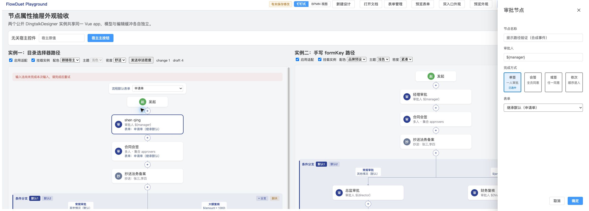

# #102 Element Plus 首批外观整批验收收尾

## 当前结论

2026-11-09，用户明确选择“接受证据限制，完成本批收尾”。本批在保留原生 IME 未验证的前提下结束追加投入；这不是全部实测通过的声明。最终决策、证据状态和外部操作边界见 [本批最终裁定](102-native-ime-manual.md#本批最终裁定2026-11-09)。#102 保持打开，不推送、不开 PR、不关票、不发包。

本页保留上一轮分项收尾事实。用户随后授权重新核对原生路径的判定口径，并准备一次无自动化控制的人工验收；该轮的口径、上限和状态以 [原生 IME 口径及接管结果记录](102-native-ime-manual.md) 为准。用户后续改由 Codex 操作，两入口普通输入操作已完成，目标原生组合路径未观察到；人工停止原物和自动化回读分别归档。新增结果不把本页历史合成事件改写为原生通过。

2026-11-09，#103–#108 已完成并合入，工程复验通过。提示代码失效未被本轮证据证实：实际输入与点击记录中，组合结束事件先于“确定”点击；另以 Chromium 合成组合事件证明，组合仍有效时会拒绝提交、显示提示并保留输入。

本次完成分项证据归档，不宣称整批正式全部验收通过。真实 OS 输入法下“提交处理时组合仍有效”的拒绝分支尚无无合成干预的实测证据；当前事件序列的 `compositionend.isTrusted=false`，来源未知。这一限制不能用自动回归或历史“五步全部通过”表述豁免。#102 保持打开。

本次只更新验收文档与原物，没有修改产品代码、依赖、公开 API 或验收规格，也没有扩大兼容矩阵。不推送、不开 PR、不关票、不发包、不部署。

## 基线与证据来源

- 分支：`feat/102-appearance-acceptance`；开工时工作区干净，拉取后 HEAD 与 `origin/develop` 均为 `921f743c942302e271b024014fb442dbfbfcb1ce`，沿用同一已隔离验收任务的分支。
- #103–#108 分别由 PR #109、#110、#112、#113、#114、#115 合入，原实施、补修和审查结论沿用各 PR；[PR #115 读回原物](evidence/102-acceptance-20261109/pr-115.json) 证明最终合入提交及 Node 22／24 CI 均成功，不代表本次文档补丁有新远端 CI。
- T01–T14 的源码与实际 tarball 消费证据沿用 [#108 验证记录](108-dual-entry-consumer-verification.md)；本次不重跑其 19 个浏览器分项或重新打包消费。最终产品修复后仅重跑受影响整合脚本的历史边界保持。
- [2026-11-06 整批核对](https://github.com/flowduet/flowduet/issues/102#issuecomment-6682347796) 与 [2026-11-09 T07 五步报告](https://github.com/flowduet/flowduet/issues/102#issuecomment-6733682602) 均作为历史报告保留；[原评论快照](evidence/102-acceptance-20261109/issue-102-prior-comments.json) 不因本次补充而改写。

## 环境与方法

本机 macOS 15.6（24G84）、x64，Node v24.18.0、pnpm 10.26.1。Chrome 完整版本 157.0.8103.38 来自当日已有验收报告；本次浏览器 UA 为 Chrome/157.0.0.0，实际页面视口 2320×833、DPR 1，见事件原物。输入法按用户操作指引使用系统简体拼音；本次未独立读取运行时输入源标识。

载体为源码 Playground `http://127.0.0.1:5173/` 的双入口场景，通过公开 `DingtalkDesigner` 实例一的节点名称输入、确定按钮、模型 change 计数与可见节点回读验证，没有调用私有组件状态。

Computer Use 的逐键接口未产生候选组合态，故未将其普通英文字母输入计作 OS IME。用户协助连续完成输入及点击后，代理读取临时 DOM 捕获记录；记录器只观察公开输入／点击事件和 DOM，不拦截、不改事件、不改组件状态。早先页面回到主流程旧入口的一次人工操作未被有效记录，不用于结论。有效记录在恢复双入口实例并固定 `change 0` 后采集。

## 真实输入与点击的实际结果

[43 条事件原物](evidence/102-acceptance-20261109/ime-click-events.json) 中的关键顺序如下；时间为同一页面 `performance.now()` 的毫秒值。

| 时刻           | 观察                                                                        | 可支持的结论                                                            |
| -------------- | --------------------------------------------------------------------------- | ----------------------------------------------------------------------- |
| 2310199.0      | 节点名称 `compositionstart`，`isTrusted=true`                               | 浏览器接收到了可信组合开始事件                                          |
| 2311203.6      | `input`，`isTrusted=true`、`isComposing=true`，值为 `shen qing`，`change 0` | 该时刻组合输入到达，尚未提交模型                                        |
| 2313105.9      | `compositionend`，`isTrusted=false`，`change 0`                             | 提交点击前已通知页面结束组合；其合成来源未知，不能说是原生 IME 自然结束 |
| 2313120.4      | 确定按钮 `pointerdown`，`isTrusted=true`                                    | 发生在组合结束事件之后约 14.5ms                                         |
| 2313267.1      | 确定按钮 `click`，`isTrusted=true`，此前仍为 `change 0`                     | 显式确定操作触发提交                                                    |
| 2313284.3 以后 | `change 1`；最终抽屉关闭，无 action-error                                   | 模型在显式点击后才变更；重新打开读回名称为 `shen qing`                  |

用户回报该次“抽屉已关闭”，与 DOM 结果一致。结合现有源码 `NodePropertyFields.vue` 的组合标记与 `NodeDrawer.vue` 的 capture 守卫，结束事件早于点击可以解释这次未进入组合态提示分支。这里没有证据证明“组合仍有效时绕过了守卫”，也没有证据证明合成结束事件由谁注入；不据此改产品代码或裁定原生提交保护通过。

## Chromium 提示分支验证

另以明确标注的合成 `CompositionEvent`／`InputEvent` 保持组合标记，再通过公开 DOM 确定按钮 `.click()` 触发既有处理。它不是 OS 输入法验收，不与上述人工记录混用。

[结果原物](evidence/102-acceptance-20261109/synthetic-prompt.json) 证明：

- `change 1` 前后不变，抽屉仍打开。
- 输入值“提示路径验证（合成事件）”保留。
- 内联提示为“输入法尚未完成本次输入，请完成后重试”，计算 `display=block`，实际截图可见。

验证后已移除临时监听和全局记录对象，结束合成组合并取消合成草稿；重新打开后名称为人工已提交的 `shen qing`，`change 1`，未把合成内容写进模型。页面保留在双入口实例一抽屉；既有内联错误横幅仍可见，不代表又发生一次提交。无持久化保存。

## T07 与整批门槛裁定

| 项目                                           | 本次裁定                                                             |
| ---------------------------------------------- | -------------------------------------------------------------------- |
| 当日历史五步报告                               | 保留为既有报告，覆盖来源、方法和限制；没有本轮重新执行全部五步的结论 |
| 组合输入到达且点击前模型不变                   | 本轮捕获可信 compositionstart／input，点击前 `change 0`              |
| 本次确定点击没有提示                           | 先发生组合结束事件，未进入仍在组合的拒绝分支；不能单据此认定提示失效 |
| 组合仍有效时的拒绝、提示与输入保留             | 既有组件回归和本次 Chromium 合成事件通过                             |
| 原生 OS IME 在提交处理时仍处于组合态的拒绝分支 | 仍未验证；当前记录夹杂来源未知的合成 compositionend，不能算通过      |
| 整批正式全部验收                               | 暂不作通过裁定；不能将分项归档完成等同于所有门槛关闭                 |

## 工程复验

以下均针对未改产品代码的上述基线运行，原始日志随本次文档保留。

| 命令         | 结果                                                                                                                                  |
| ------------ | ------------------------------------------------------------------------------------------------------------------------------------- |
| `pnpm test`  | 66 文件／1025 项通过：core 148、designer 202、form-create 368、Playground 307；[日志](evidence/102-acceptance-20261109/pnpm-test.txt) |
| `pnpm build` | 通过，含各包既有类型生成与类型检查；仍有 Vite 大 chunk 警告；[日志](evidence/102-acceptance-20261109/pnpm-build.txt)                  |
| `pnpm lint`  | 通过；[日志](evidence/102-acceptance-20261109/pnpm-lint.txt)                                                                          |

先行执行 designer 测试实际运行了该包全部 15 文件／202 项，通过，其中已有外观测试断言组合态提示。本轮只做证据核实和归档，沿用已确认的公开组件和 DOM 交互接缝及现有回归，没有新增行为测试。没有另外运行全 Playground vue-tsc；#108 记录的既有检查失败不因 build 通过而被改写。没有执行部署冒烟，因为本轮没有 BPMN 或引擎产物变更，也未获部署授权。

## 审查与恢复

本次补丁只包含验收记录、人工步骤澄清和证据原物，但会影响验收结论，已按项目约定做独立审查。固定基线为上述 SHA；审查时未提交补丁含全部 11 个文件（含新增文件），补丁 SHA-256 为 `293fc48b3eaf20ff7dacf6fbbfd20b2935d726095ff9210516daf7a93b3fe097`，三位审查者分别核对快照与文件哈希一致。

- Standards：重要 0／细节 0／既有问题 0。
- Spec：重要 0／细节 0／既有发现 0；README 澄清没有放宽组合有效时拒绝提交的合同。
- 证据来源专项：重要 0／细节 0／既有问题 0；时序、计数、合成提示结果与截图一致。归档未单列清理后的 DOM／监听快照，因此清理段落只可由本轮工具回读及源码一致性支持，不能从归档 JSON 独立重建监听删除过程。

三轴均无须修复。审查后仅补记本节结果、精简测试说明和格式，不变更验收裁定、事件原物或产品。原产品行为、验收规格和历史结果保持。若需撤回本次结论，可回退本地文档提交并在工单追加更正，不改写历史评论；本轮未执行回退实测。

## 剩余边界与下一步责任

Firefox、Safari／WebKit、移动端、搜狗输入法、其他 EP 版本／多副本、完整可访问性认证和第三方渲染器故障注入未新增验证。本地 tarball 历史消费通过不等于 npm 已发包，源码宿主的本次输入记录不等于 tarball 的 OS IME 实测。

本轮由实施方提交本地证据并在 #102 追加分项结论，工单保持打开。若维护者要裁定整批正式通过，下一步由验收者在无中途合成 compositionend 干预的系统简体拼音环境，按 Playground README 的步骤 3 补充事件顺序及对应可见结果；实施方据实际结果更新 T07，若证实组合仍有效时提前提交或丢字，则先修复并回归。当前没有后台补测任务，不承诺自动跟进。

你现在无需操作。本次交付以分项结论与剩余缺口为准，不追加兼容矩阵或继续反复要求人工输入。推送、PR、关闭父票与发包仍分别由用户／维护者决定。
